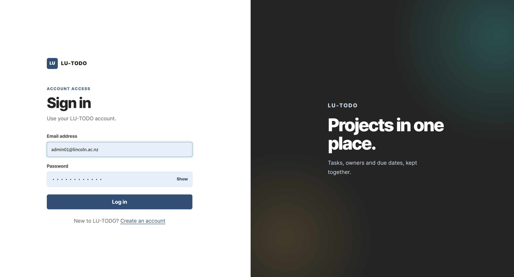
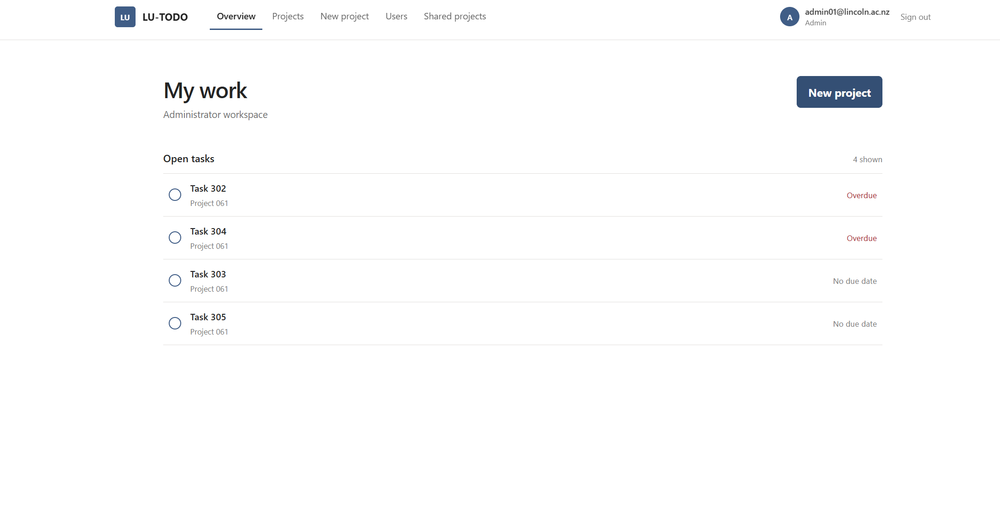

# LU-TODO

LU-TODO is a Flask and PostgreSQL project-management application for Lincoln University teams. It keeps projects, tasks, due dates, priorities and collaborators in one focused workspace.

The application was developed as an individual COMP639 project and includes role-based access for students, staff and administrators.

## What it demonstrates

- Flask application structure with separate route modules for users, projects, tasks, sharing and administration.
- PostgreSQL relational data model for users, projects, tasks and project membership.
- Authentication, account status checks and role-based authorization.
- Project and task CRUD workflows with validation, priorities, due dates and overdue states.
- Shared projects for staff and administrators, with member management.
- Responsive, minimal interface for dashboards, project lists, project workspaces and administration.

## Role permissions

| Role | Main capabilities |
| --- | --- |
| Student | Create and manage projects and tasks, view projects shared with them, update their profile |
| Staff | Student capabilities plus share owned projects with collaborators |
| Admin | Staff capabilities plus manage users, account status, roles and shared-project ownership |

## Demo accounts

These accounts are included by `database/populate_database.sql` and are intended for local demonstration only.

| Role | Email | Password |
| --- | --- | --- |
| Admin | `admin01@lincoln.ac.nz` | `Admin01!Pass` |
| Staff | `staff01@lincoln.ac.nz` | `Staff01!Pass` |
| Student | `student01@lincolnuni.ac.nz` | `Student01!Pass` |

The seed script also generates additional accounts using the same pattern (`admin02`, `staff02`–`staff10`, and `student02`–`student50`). Do not use these passwords for a public or production deployment.

To regenerate the development dataset after changing the data generator:

```powershell
python scripts/generate_test_data.py
```

This overwrites `database/populate_database.sql`, so run it only when you intend to replace the local seed data.

## Requirements

- Python 3.12 or later
- PostgreSQL 14 or later
- A PostgreSQL database named `lutodo`

## Run locally

### 1. Clone and create an environment

```powershell
git clone https://github.com/Ming-Liu-1170030/LU-TODO.git
cd LU-TODO

conda create -n lutodo python=3.12
conda activate lutodo
python -m pip install -r requirements.txt
```

### 2. Prepare PostgreSQL

Create a database named `lutodo`, then run the schema and development seed data:

```powershell
psql -U postgres -d lutodo -f database/create_database.sql
psql -U postgres -d lutodo -f database/populate_database.sql
```

`database/populate_database.sql` clears and repopulates application tables. Use it only for local development or a disposable demo database.

### 3. Provide the database password

The application reads the PostgreSQL password from `LUTODO_DB_PASSWORD` rather than storing it in source code.

```powershell
$env:LUTODO_DB_PASSWORD = Read-Host "PostgreSQL password" -MaskInput
python run.py
```

Open <http://127.0.0.1:5000> in a browser.

## Project structure

```text
LU-TODO/
├── lutodo/
│   ├── templates/       Jinja pages
│   ├── static/          CSS, JavaScript and profile assets
│   ├── db.py            Database helpers and queries
│   ├── project.py       Project routes
│   ├── task.py          Task routes
│   ├── sharing.py       Project-member routes
│   ├── user.py          Authentication and profile routes
│   └── admin.py         Administrator routes
├── scripts/
│   ├── generate_test_data.py      Development seed-data generator
│   └── generate_password_hashes.py Optional bcrypt helper
├── docs/
│   └── screenshots/               README preview images
├── database/
│   ├── create_database.sql  PostgreSQL schema
│   └── populate_database.sql Development data and demo accounts
├── run.py               Application entry point
└── requirements.txt     Python dependencies
```

## Design notes

The public entry and login screens use a restrained split layout. Authenticated pages use a compact top navigation and content-first layouts. The interface intentionally avoids dashboards filled with decorative cards: the main screens prioritise projects, open tasks and the next available action.

## Screenshots

### Login



### Administrator overview



## Testing and checks

Before committing changes, run the application locally and verify each role using the demo accounts. At minimum, check login, project creation, task editing, member sharing and administrator-only pages.


